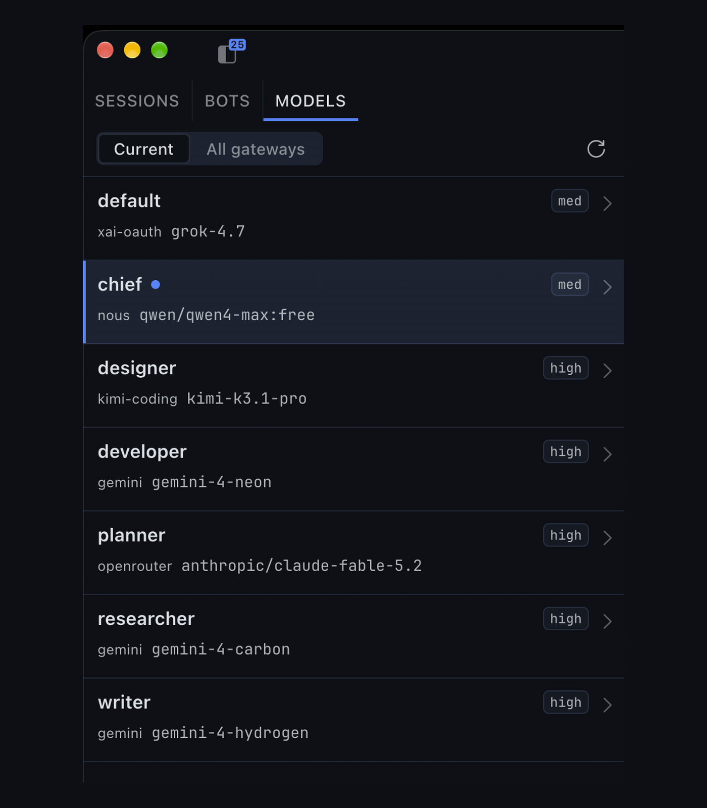
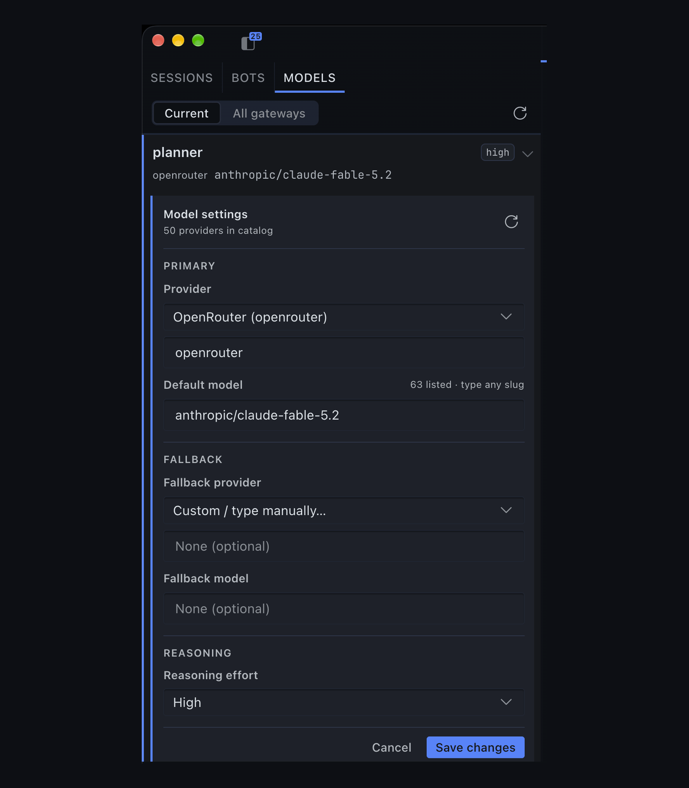

# Model Tab

A standalone [Hermes Desktop](https://hermes-agent.nousresearch.com/docs/developer-guide/desktop-plugin-sdk) plugin (`id: model-tab`) that adds a **Models** tab to the left sidebar (docked with **Sessions** and **Bots**) for inspecting and editing model settings across Hermes profiles.

## Screenshots

<p>
  
  
</p>

## Features

- **Profile overview:** View each profile's primary provider/model, fallback model, and reasoning effort for the **Current** gateway or across **All gateways** (manual refresh, lazy fetch on expand/scope change, no auto-polling).
- **Inline editor:** Edit primary provider and default model with live catalog suggestions (`model.options`) or manual model slugs, update or clear the fallback chain (`fallback_providers`, clearing legacy `fallback_model` when present), and set reasoning effort (`default` through `ultra`).
- **Safe writes:** Uses gateway RPC (`profiles.configure`, `config.set`, and `cli.exec config`) with expensive-model confirmation support and an optional `config.yaml` force-write fallback when a provider/model is unlisted or unconfigured. Saves update profile defaults only; they do not change models pinned to existing chats.
- **Native styling, no build step:** Plain uncompiled ESM using `@hermes/plugin-sdk` components and Hermes `--ui-*` theme variables.

## Requirements

A current [Hermes Desktop](https://hermes-agent.nousresearch.com/docs/developer-guide/desktop-plugin-sdk) app with the desktop plugin SDK (`@hermes/plugin-sdk`). This is a native disk plugin for the desktop app, not a web-dashboard plugin.

## Installation

Standalone desktop plugins load from the app-level `desktop-plugins/` directory inside `$HERMES_HOME`. On macOS and Linux this defaults to `~/.hermes`:

- `~/.hermes/desktop-plugins/model-tab/` (or `$HERMES_HOME/desktop-plugins/model-tab/` if `HERMES_HOME` is set)

The folder name **must** match the plugin ID (`model-tab`). One `desktop-plugins/` root serves all profiles and connections in Hermes Desktop. On Windows, use the same `$HERMES_HOME/desktop-plugins/model-tab` path, with `HERMES_HOME` pointing at your Hermes data directory.

### HTTPS (recommended)

**macOS / Linux**

```bash
mkdir -p "${HERMES_HOME:-$HOME/.hermes}/desktop-plugins"
git clone https://github.com/dryholeco/model-tab.git \
  "${HERMES_HOME:-$HOME/.hermes}/desktop-plugins/model-tab"
```

**Windows (PowerShell)**

```powershell
# Set HERMES_HOME to your Hermes data directory if it is not already set.
if (-not $env:HERMES_HOME) { throw "Set HERMES_HOME to your Hermes data directory, then retry." }
New-Item -ItemType Directory -Force -Path (Join-Path $env:HERMES_HOME "desktop-plugins") | Out-Null
git clone https://github.com/dryholeco/model-tab.git (Join-Path $env:HERMES_HOME "desktop-plugins\model-tab")
```

### GitHub CLI

```bash
mkdir -p "${HERMES_HOME:-$HOME/.hermes}/desktop-plugins"
gh repo clone dryholeco/model-tab \
  "${HERMES_HOME:-$HOME/.hermes}/desktop-plugins/model-tab"
```

### SSH

```bash
mkdir -p "${HERMES_HOME:-$HOME/.hermes}/desktop-plugins"
git clone git@github.com:dryholeco/model-tab.git \
  "${HERMES_HOME:-$HOME/.hermes}/desktop-plugins/model-tab"
```

**Windows (PowerShell, SSH)**

```powershell
if (-not $env:HERMES_HOME) { throw "Set HERMES_HOME to your Hermes data directory, then retry." }
New-Item -ItemType Directory -Force -Path (Join-Path $env:HERMES_HOME "desktop-plugins") | Out-Null
git clone git@github.com:dryholeco/model-tab.git (Join-Path $env:HERMES_HOME "desktop-plugins\model-tab")
```

### Loading and managing

1. Hermes Desktop watches `desktop-plugins/` and loads the plugin automatically within a few seconds.
2. If the **Models** tab does not appear right away, open the command palette (**⌘K** on macOS, **Ctrl+K** on Linux/Windows) and run **Reload desktop plugins**.
3. Toggle **Model Tab** on or off at any time in **Capabilities → Plugins**.

### Updating

**macOS / Linux**

```bash
git -C "${HERMES_HOME:-$HOME/.hermes}/desktop-plugins/model-tab" pull
```

**Windows (PowerShell)**

```powershell
git -C (Join-Path $env:HERMES_HOME "desktop-plugins\model-tab") pull
```

Hermes Desktop hot-reloads `plugin.js` automatically when the file is updated on disk.

## Usage

1. Open the **Models** tab in the left sidebar (next to **Sessions** and **Bots**).
2. Use **Current** to inspect profiles on the active gateway, or **All gateways** to group profiles by connection. Switching scope or expanding a row fetches data lazily; nothing is auto-polled.
3. Click a profile row to expand the inline editor. You can change settings without switching chats or opening `config.yaml`.
4. Pick a provider and model from the catalog, or type any provider or model ID.
5. **Save changes** updates that profile's defaults (provider, default model, fallback, and reasoning effort). It does not change models pinned to existing chats.

## Uninstall

1. Toggle **Model Tab** off in **Capabilities → Plugins**.
2. Delete the plugin folder (`${HERMES_HOME:-$HOME/.hermes}/desktop-plugins/model-tab` on macOS and Linux, or `$HERMES_HOME/desktop-plugins/model-tab` on Windows).
3. If the tab is still visible, run **Reload desktop plugins** from the command palette.

The plugin stores no local `ctx.storage` state. Profile model settings remain in each profile's `config.yaml`.

## License

MIT. See [LICENSE](LICENSE).
